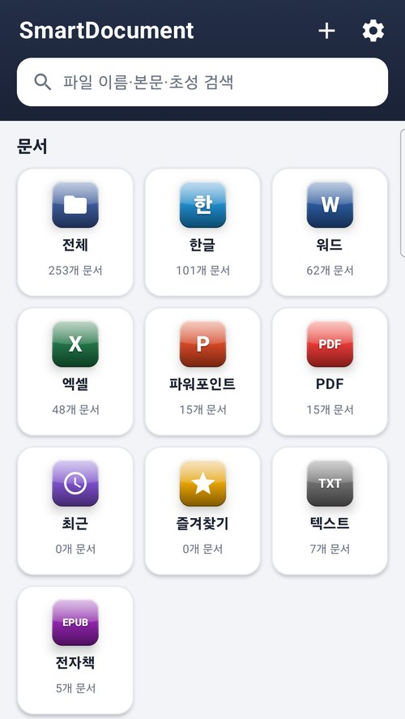
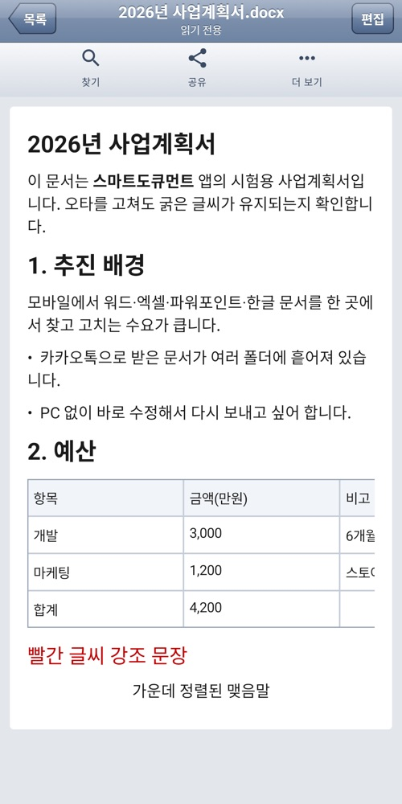
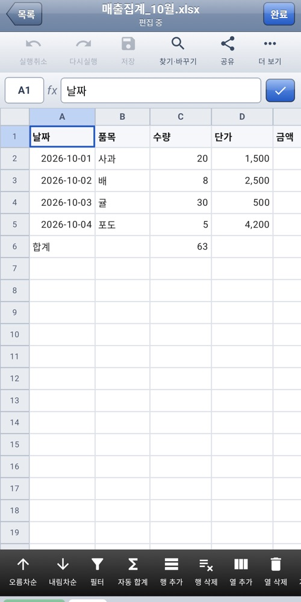
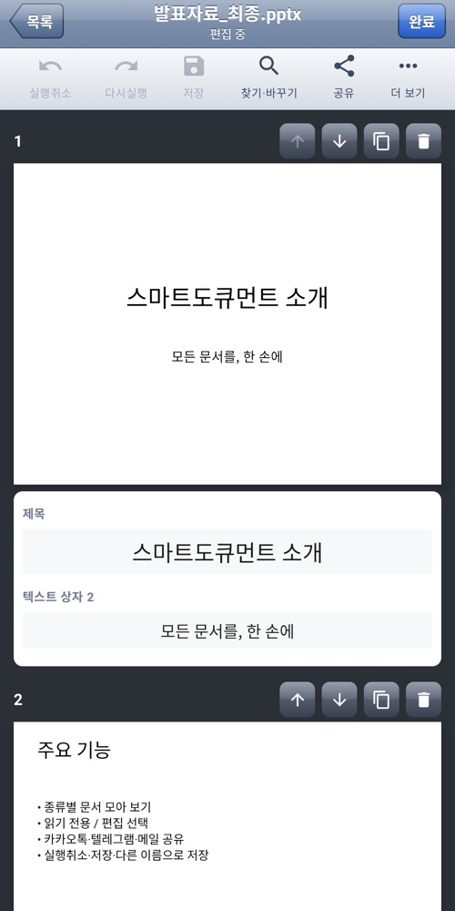
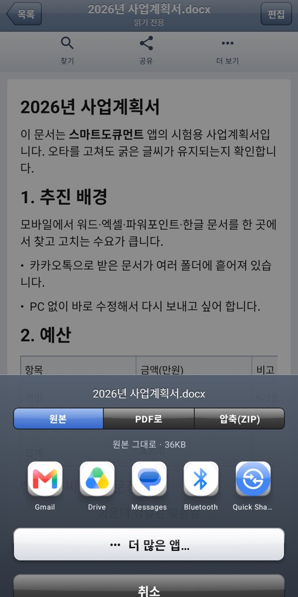
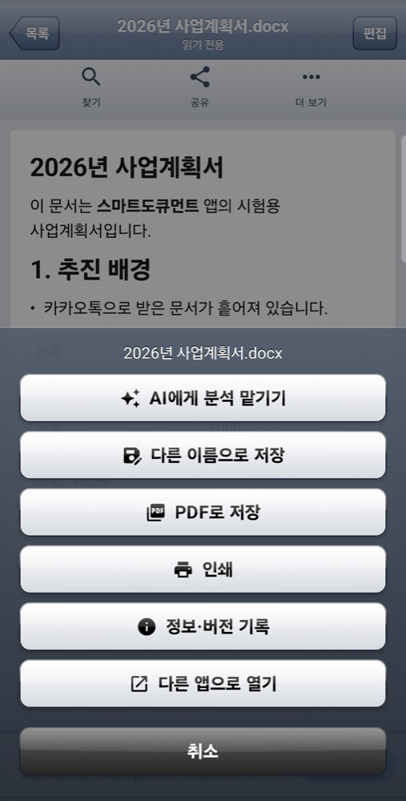
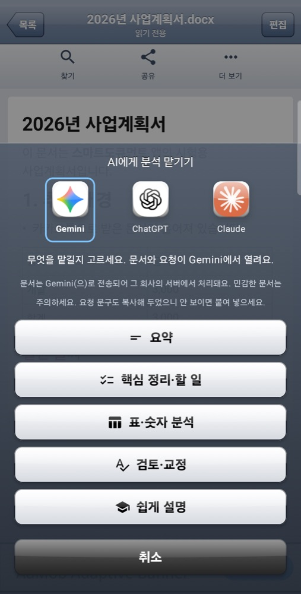
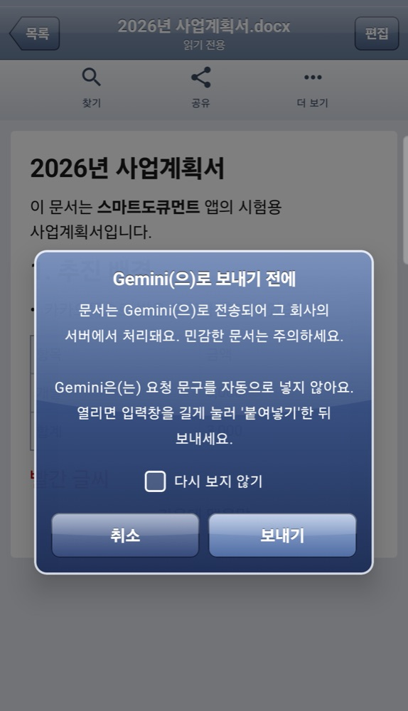
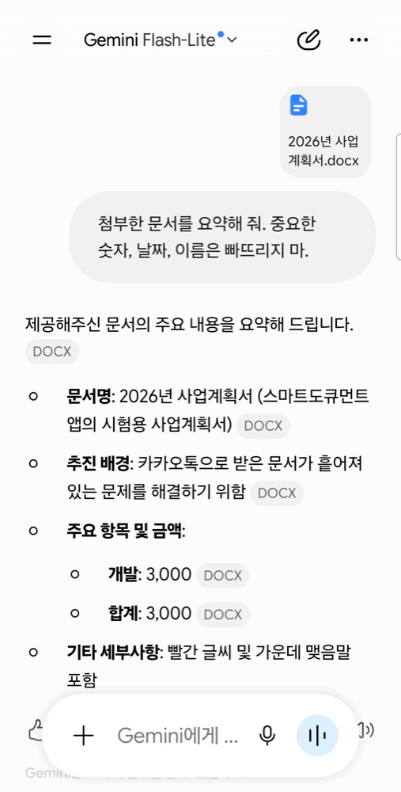
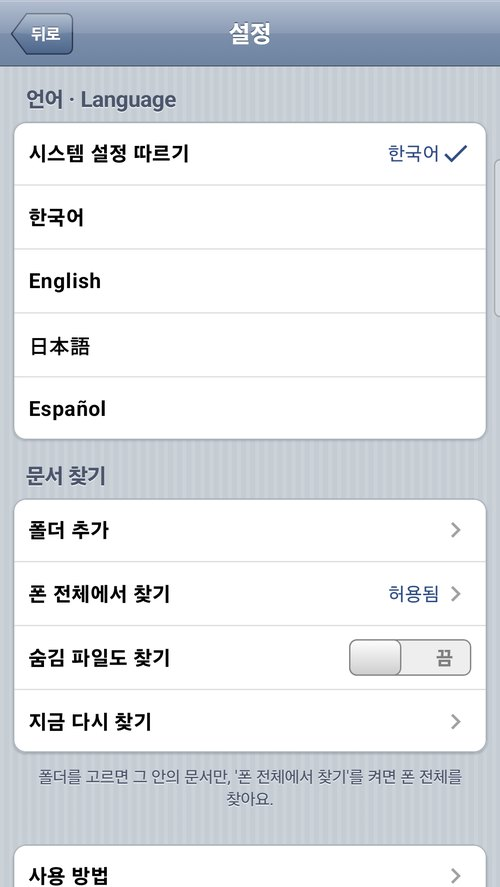

Every time I opened a document on my phone, the same thing happened. I couldn't find which folder the file from a messenger chat had landed in, I needed a separate app to open it, and fixing a single typo meant going back to a PC. So I built my own. **SmartDocument** is an Android document app that finds every document on your phone, groups them by type, and lets you read, edit and send them from one app. The latest update adds a way to **hand a document to an AI app for a summary or analysis**.

It's currently in **closed testing** on Google Play. This post walks through how to use it with screenshots, and explains how to join the beta at the end.

## Features at a glance

- **Automatic discovery**: scans the whole phone (Downloads, messenger folders, Documents and more) and sorts files into Hangul, Word, Excel, PowerPoint, PDF and text.
- **Read, edit, save**: open and edit Hangul (HWP, HWPX), Word, Excel and PowerPoint files in one app, and save them back in their original format.
- **Old and unusual formats**: Hangul 97-era HWP 3.0 files, Hancom Cell/Show, Excel binary (.xlsb), Apple Pages/Numbers/Keynote, EPUB e-books and XPS.
- **Send**: share as the original, as a PDF or as a ZIP to messengers, email or cloud drives.
- **Ask AI to analyze**: pick Summarize, Key points & to-dos, Analyze tables & numbers, Proofread & review or Explain simply, and send the document straight to Gemini, ChatGPT or Claude.

| Type | Formats |
|---|---|
| Hangul | HWP, HWPX, HWT/HWTX templates, HML, HWP 3.0 |
| Word | DOCX, DOC, DOTX/DOCM, RTF, ODT, Pages |
| Excel | XLSX, XLS, XLSB, XLSM/XLTX, CSV/TSV, ODS, Hancom Cell, Numbers |
| PowerPoint | PPTX, PPT, PPSX/POTX, ODP, Hancom Show, Keynote |
| Other | PDF, XPS, EPUB, TXT/MD |

## 1. First launch: it finds your documents for you

On first launch the app asks for "All files access". Allow it and the app scans the whole phone; or skip it and pick specific folders instead.

- The icon row at the top jumps straight to **All, Recent, Favorites, Word, Excel, PowerPoint, Hangul and PDF**. Red badges count new documents.
- Search covers **file names and the text inside documents**, and even Korean initial consonants.
- Sort by modified date, name, size, type or **source** (messenger, Downloads and so on).

## 2. Reading and editing

Tap a document to read it; tap **Edit** in the top right to change it.

For Word and Hangul files, the app rewrites **only what you changed**, so fixing a typo keeps formatting like bold and colors intact. Undo/redo and find & replace are built in.

In spreadsheets, tap a cell to change it and use the bottom toolbar to **sort, filter, auto-sum and add or delete rows and columns**. Formulas are recalculated.

In presentations, edit the text on each slide and reorder, duplicate or delete slides.

## 3. Sending in the right format

The share button lets you choose **Original, As PDF or ZIP**. If the recipient probably doesn't have an office or Hangul app, send a PDF. Your six most-used apps stay pinned at the top.

## 4. New: Ask AI to analyze

When a long notice, contract or meeting deck lands on your phone, you often just want to know "so what do I need to do?" Open the document and tap **More → Ask AI to analyze**.

<figure style="margin:0;text-align:center"><figcaption style="font-size:.85em;opacity:.8;margin-top:6px">1. More → Ask AI to analyze</figcaption></figure>
<figure style="margin:0;text-align:center"><figcaption style="font-size:.85em;opacity:.8;margin-top:6px">2. Pick an AI app and a task</figcaption></figure>
<figure style="margin:0;text-align:center"><figcaption style="font-size:.85em;opacity:.8;margin-top:6px">3. Notice before sending (can be hidden)</figcaption></figure>
<figure style="margin:0;text-align:center"><figcaption style="font-size:.85em;opacity:.8;margin-top:6px">4. Gemini's summary of the document</figcaption></figure>

1. The AI apps installed on your phone (Gemini, ChatGPT, Claude and others) appear. Pick one.
2. Choose a task: **Summarize / Key points & to-dos / Analyze tables & numbers / Proofread & review / Explain simply**.
3. The first time, a notice explains that the document will be processed on that AI company's servers. Tick "Don't show again" to skip it next time.
4. The AI app opens with the document attached. Tap send.

Here's where SmartDocument helps: **AI apps like Gemini can't take Hangul (HWP, HWPX) or PowerPoint files directly.** So SmartDocument converts them before sending — Hangul and PowerPoint become PDF, and spreadsheets like Hancom Cell or Numbers become Excel (XLSX). When I sent a Hangul 97-era government form to Gemini this way, it summarized it accurately, down to the statute numbers and agency names.

> **Tip for Gemini and Claude**: these two apps don't fill in the request text automatically. SmartDocument copies it for you, so long-press the input box, tap Paste and send. ChatGPT fills it in automatically.

## 5. Settings

- **When you tap a document**: ask, open for viewing, or open for editing.
- **Previous versions**: every save keeps the previous content on the phone, so you can roll back from "Info & versions" (5 to 50 versions).
- **Full-text search**: find documents by the words inside them.

## FAQ

**Documents I received in a messenger don't show up.** Recent Android versions block other apps from reading some messengers' private folders. Open the document in the messenger, choose "Open with another app → SmartDocument", and a copy is kept so it appears in the list from then on.

**Do my documents leave the phone?** Reading, editing and search all happen on the phone. A document only leaves when you share it yourself or send it to an AI app with "Ask AI to analyze".

**Is there anything it can't open?** Distribution-only Hangul files protected by their author can be viewed but not edited or sent to AI. Password-protected files are reported as such.

## Join the beta

SmartDocument is in closed testing. If you have an Android phone, you can join in three steps:

1. **Join the tester group**: click "Join group" at [groups.google.com/g/cnklab_tester](https://groups.google.com/g/cnklab_tester)
2. **Opt in to testing**: click "Become a tester" at [play.google.com/apps/testing/com.menewsoft.smartdocument](https://play.google.com/apps/testing/com.menewsoft.smartdocument)
3. **Install the app**: [get it on Google Play](https://play.google.com/store/apps/details?id=com.menewsoft.smartdocument)

Make sure the Play Store is signed in with the same Google account you used to join the group. Open the documents you use every day — Hangul files especially — and let me know through the [contact page](/en/contact/) if anything fails to open or looks broken.

Like the other tools and games on this site, this app was built together with an AI coding agent. I wrote about that process in [I Let an AI Coding Agent Build Five Browser Games](/en/blog/shipping-five-ai-built-games-2026/).
