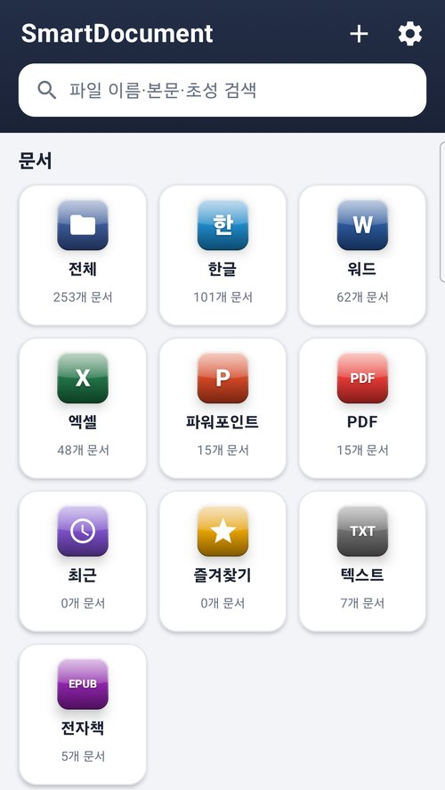
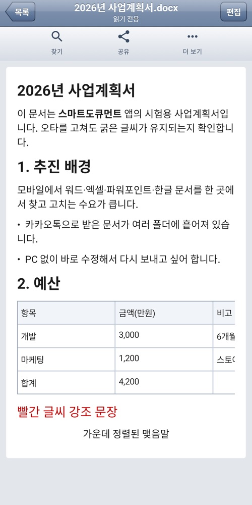
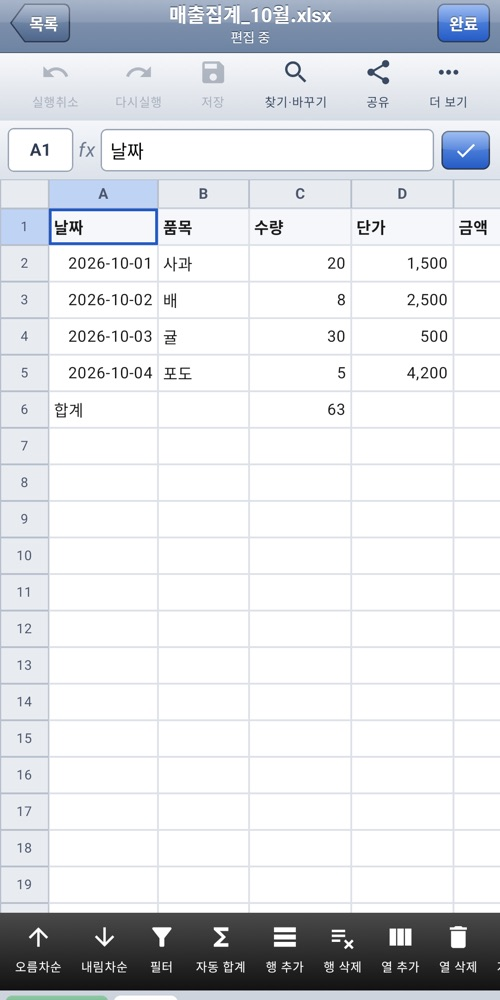
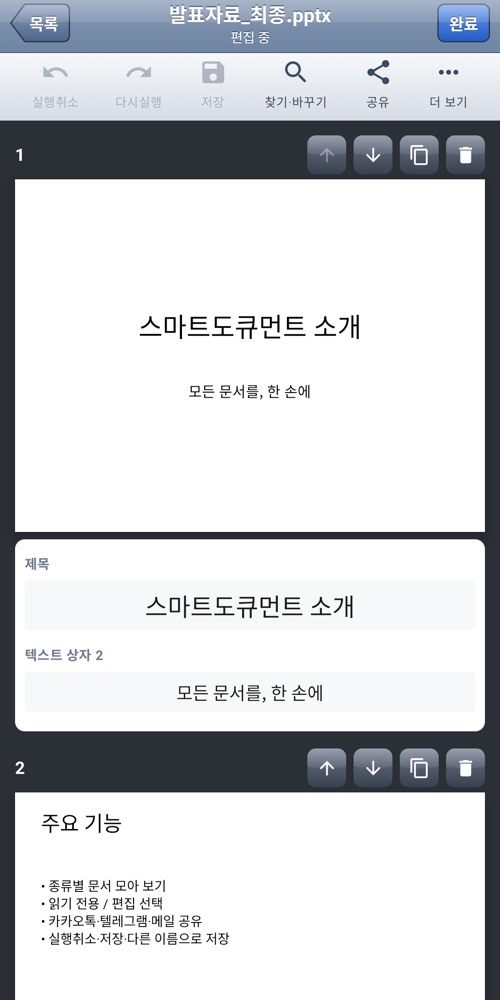
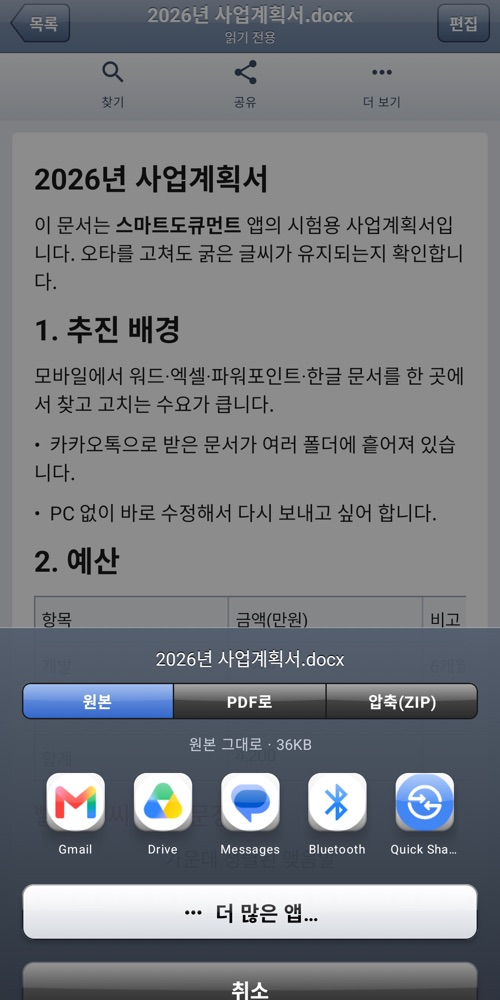
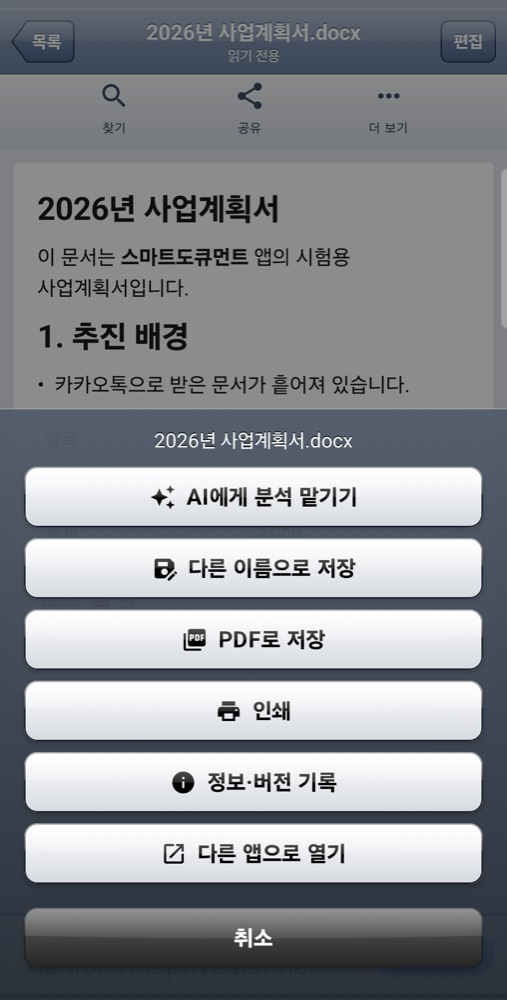
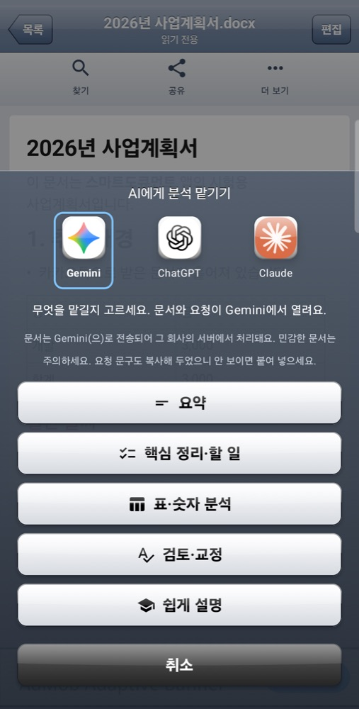
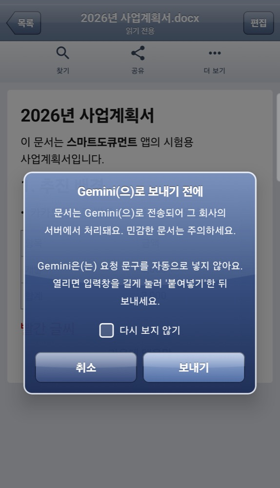
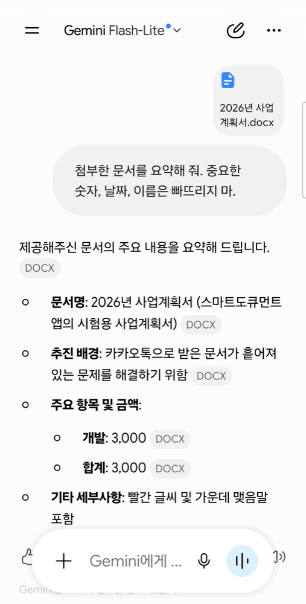
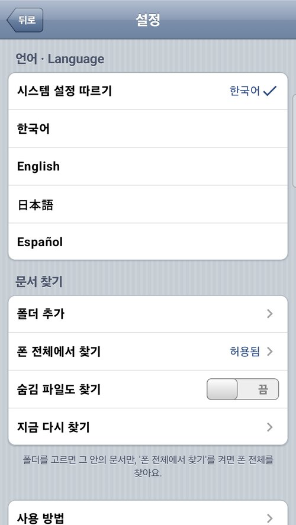

휴대폰으로 문서를 열 때마다 같은 일을 겪었다. 카톡으로 받은 한글 파일은 어느 폴더에 있는지 모르겠고, 열려면 앱을 따로 깔아야 하고, 오타 하나 고치려면 결국 PC 앞에 앉아야 했다. 그래서 직접 만들었다. **스마트도큐먼트(SmartDocument)** 는 폰 안의 모든 문서를 자동으로 찾아 종류별로 모아 주고, 앱 하나로 읽고 고치고 보내는 안드로이드 문서 앱이다. 이번 업데이트에서는 **문서를 AI에게 맡겨 요약·분석하는 기능**도 들어갔다.

지금은 Google Play **비공개 테스트** 중이다. 이 글에서 화면 캡처와 함께 사용법을 정리하고, 마지막에 테스터 참여 방법을 적어 두었다.

## 한눈에 보는 기능

- **자동 찾기·분류**: 폰 전체(다운로드, 카카오톡, 문서 폴더 등)의 문서를 찾아 한글·워드·엑셀·파워포인트·PDF·텍스트로 나눠 보여 준다.
- **읽기·고치기·저장**: 앱 하나로 한글(HWP·HWPX), 워드, 엑셀, 파워포인트를 열고 바로 수정한다. 고친 내용은 원래 형식 그대로 저장한다.
- **옛 문서·특이한 형식도**: 한글 97 이전(HWP 3.0) 문서, 한셀·한쇼, 엑셀 바이너리(.xlsb), Apple Pages·Numbers·Keynote, 전자책(EPUB), XPS까지 열린다.
- **보내기**: 원본·PDF·압축(ZIP) 중 골라 카카오톡·메일·드라이브로 보낸다.
- **AI에게 분석 맡기기**: 요약, 핵심 정리, 표·숫자 분석, 검토·교정, 쉽게 설명을 골라 Gemini·ChatGPT·Claude 앱으로 바로 넘긴다.

| 종류 | 여는 형식 |
|---|---|
| 한글 | HWP, HWPX, HWT·HWTX(서식), HML, HWP 3.0 |
| 워드 | DOCX, DOC, DOTX·DOCM, RTF, ODT, Pages |
| 엑셀 | XLSX, XLS, XLSB, XLSM·XLTX, CSV·TSV, ODS, 한셀(.cell), Numbers |
| 파워포인트 | PPTX, PPT, PPSX·POTX, ODP, 한쇼(.show), Keynote |
| 기타 | PDF, XPS, EPUB, TXT·MD |

## 1. 처음 실행: 문서를 알아서 찾아 준다

처음 켜면 '모든 파일 접근' 권한을 묻는다. 허용하면 폰 전체를 훑어 문서를 모아 온다. 허용하지 않고 특정 폴더만 골라도 된다.

- 맨 위 아이콘 줄에서 **전체·최근·즐겨찾기·워드·엑셀·파워포인트·한글·PDF** 를 바로 고른다. 빨간 숫자는 새로 들어온 문서 수다.
- 검색창은 **파일 이름뿐 아니라 본문 내용, 초성(ㅅㅇㄱㅎ)** 까지 찾는다.
- 수정일·이름·크기·종류·**출처(카카오톡·다운로드 등)** 로 정렬한다.

## 2. 문서 읽고 고치기

문서를 누르면 바로 읽기 화면이 열리고, 오른쪽 위 **편집** 을 누르면 고칠 수 있다.

워드·한글 문서는 오타를 고쳐도 굵은 글씨·색 같은 글자 서식이 그대로 남도록 **바뀐 부분만** 고쳐 저장한다. 실행 취소·다시 실행, 찾기·바꾸기도 있다.

엑셀은 셀을 눌러 값을 바꾸고, 아래 도구 줄에서 **정렬·필터·자동 합계·행/열 추가·삭제** 를 한다. 수식도 계산된다.

파워포인트는 슬라이드마다 글자를 고치고, 순서 바꾸기·복제·삭제를 한다.

## 3. 보내기: 받는 사람에게 맞는 형식으로

공유 단추를 누르면 **원본 / PDF로 / 압축(ZIP)** 을 고를 수 있다. 상대방 폰에 한글이나 오피스 앱이 없을 것 같으면 PDF로 보내면 된다. 자주 쓰는 앱 6개는 즐겨찾기로 위에 고정된다.

## 4. 새 기능: AI에게 분석 맡기기

긴 공문, 계약서, 회의 자료를 폰으로 받았을 때 "그래서 뭘 하라는 거지?"를 빨리 알고 싶을 때가 많다. 문서를 열고 **더 보기 → AI에게 분석 맡기기** 를 누르면 된다.

<figure style="margin:0;text-align:center"><figcaption style="font-size:.85em;opacity:.8;margin-top:6px">① 더 보기 → AI에게 분석 맡기기</figcaption></figure>
<figure style="margin:0;text-align:center"><figcaption style="font-size:.85em;opacity:.8;margin-top:6px">② AI 앱과 맡길 일 고르기</figcaption></figure>
<figure style="margin:0;text-align:center"><figcaption style="font-size:.85em;opacity:.8;margin-top:6px">③ 보내기 전 안내(다시 보지 않기 가능)</figcaption></figure>
<figure style="margin:0;text-align:center"><figcaption style="font-size:.85em;opacity:.8;margin-top:6px">④ Gemini가 문서를 요약한 결과</figcaption></figure>

1. 폰에 깔린 AI 앱(Gemini·ChatGPT·Claude 등)이 나타난다. 하나를 고른다.
2. 맡길 일을 고른다. **요약 / 핵심 정리·할 일 / 표·숫자 분석 / 검토·교정 / 쉽게 설명**
3. 처음 한 번 안내가 뜬다. 문서가 그 AI 회사의 서버에서 처리된다는 내용이다. '다시 보지 않기'를 체크하면 다음부터는 바로 넘어간다.
4. AI 앱이 열리고 문서가 첨부된다. 보내기를 누르면 끝이다.

여기서 스마트도큐먼트만의 장점이 하나 있다. **Gemini 같은 AI 앱은 한글(HWP·HWPX)이나 파워포인트 파일을 직접 받지 못한다.** 그래서 스마트도큐먼트가 보내기 전에 자동으로 바꿔 준다. 한글·파워포인트는 PDF로, 한셀·Numbers 같은 표 문서는 엑셀(XLSX)로 바꿔서 넘긴다. 실제로 한글 97 시절 공문서 서식을 Gemini에 보냈더니 법령 조항과 기관명까지 정확히 정리해 줬다.

> **Gemini·Claude 사용 팁**: 이 두 앱은 요청 문구를 입력창에 자동으로 넣어 주지 않는다. 스마트도큐먼트가 문구를 미리 복사해 두니, 입력창을 길게 눌러 '붙여넣기'한 뒤 보내면 된다. ChatGPT는 문구가 자동으로 채워진다.

## 5. 설정

- **문서를 누르면**: 물어보기 / 바로 보기 / 바로 편집 중에서 고른다.
- **이전 버전 보관**: 저장할 때마다 이전 내용을 폰 안에 보관해서, '정보·버전 기록'에서 되돌릴 수 있다(5~50개).
- **본문 내용 검색**: 켜 두면 문서 속 글자로도 찾는다.

## 자주 묻는 질문

**카톡으로 받은 문서가 목록에 안 보여요.** 최근 안드로이드는 카카오톡 전용 폴더를 다른 앱이 읽지 못하게 막는다. 카톡에서 문서를 연 뒤 '다른 앱으로 열기 → 스마트도큐먼트'를 고르면 사본이 보관되어 다음부터 목록에 나온다.

**문서가 밖으로 나가나요?** 읽기·고치기·검색은 모두 폰 안에서만 처리한다. 문서가 밖으로 나가는 건 내가 직접 공유하거나 'AI에게 분석 맡기기'로 AI 앱에 보낼 때뿐이다.

**안 열리는 문서도 있나요?** 작성자가 보호해 둔 배포용 한글 문서는 볼 수만 있고 고치거나 AI로 보낼 수 없다. 암호가 걸린 문서는 "암호가 걸린 문서"라고 알려 준다.

## 테스터로 참여하기

스마트도큐먼트는 지금 비공개 테스트 중이다. 안드로이드폰이 있다면 아래 세 단계로 참여할 수 있다.

1. **테스터 그룹 가입**: [groups.google.com/g/cnklab_tester](https://groups.google.com/g/cnklab_tester) 에서 '그룹 가입'
2. **테스트 참여 신청**: [play.google.com/apps/testing/com.menewsoft.smartdocument](https://play.google.com/apps/testing/com.menewsoft.smartdocument) 에서 '테스터 되기'
3. **앱 설치**: [Play 스토어에서 설치](https://play.google.com/store/apps/details?id=com.menewsoft.smartdocument)

그룹에 가입한 구글 계정으로 Play 스토어에 로그인돼 있어야 한다. 평소 쓰는 문서, 특히 한글 파일을 열어 보고 안 열리거나 깨지는 문서가 있으면 [문의 페이지](/contact/)로 알려 주면 큰 도움이 된다.

이 앱도 이 사이트의 다른 도구·게임처럼 AI 코딩 에이전트와 함께 만들었다. 만드는 과정은 [AI 코딩 에이전트에게 브라우저 게임 5개를 맡겨봤다](/blog/shipping-five-ai-built-games-2026/)에 적어 두었다.
